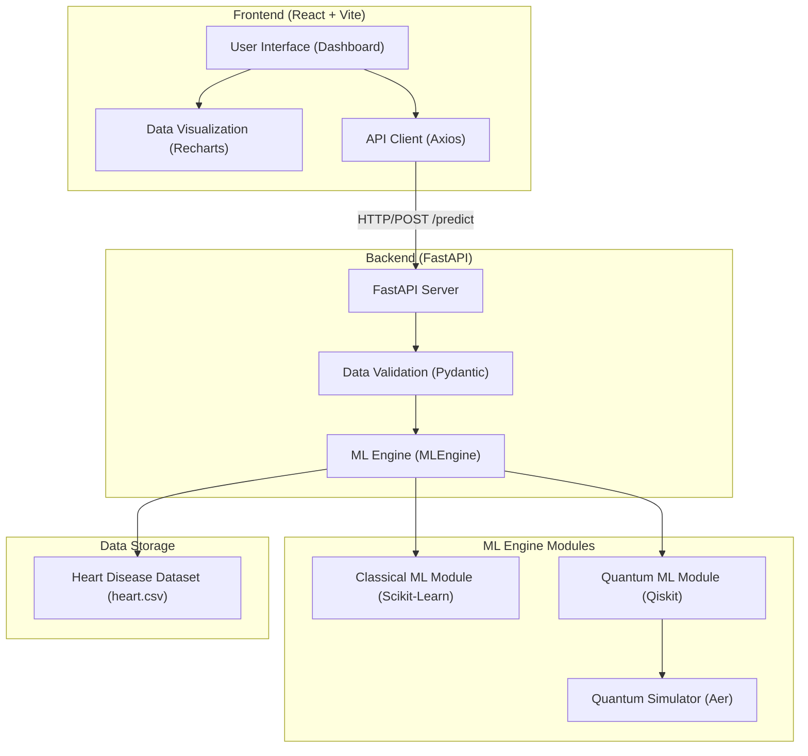

# Mini-Quantum High-Level Architecture

Mini-Quantum is a hybrid machine learning platform that allows users to compare the performance of Classical ML models against Quantum ML (QML) models using a real-world heart disease dataset.

## System Architecture Diagram

## Component Breakdown

### 1. Frontend (Client-Side)
The frontend is built with **React** and **Vite**, focusing on a premium, responsive dashboard experience.
- **Dashboard UI**: Provides interactive forms to input patient features and select models for comparison.
- **Visualizations**: Uses **Recharts** to display performance metrics (Accuracy, Precision, Recall) in real-time.
- **Glassmorphism Design**: Implements a modern dark-mode aesthetic with custom CSS.

### 2. Backend (Server-Side)
A **FastAPI** server acts as the bridge between the user interface and the machine learning models.
- **RESTful Endpoints**:
    - `GET /features`: Returns the required input features for the models.
    - `GET /models`: Lists available Classical and Quantum models.
    - `POST /predict`: Handles prediction requests by routing them to the appropriate engine.
- **MLEngine**: A central logic layer that manages model initialization, pre-processing, and prediction.

### 3. ML Engine (The Core)
The engine is split into two primary domains:
- **Classical Module**: Utilizes `scikit-learn` for established models like Logistic Regression, Random Forest, and Support Vector Machines (SVM).
- **Quantum Module**: Powered by **Qiskit**, it implements Variational Quantum Circuits (VQC) and Quantum SVMs (QSVM) using Feature Maps and Quantum Kernels.
- **Aer Simulator**: Since most users don't have access to actual quantum hardware, the quantum circuits are simulated on classical CPUs.

### 4. Data Layer
- **heart.csv**: A standard heart disease dataset used to define the input space and train the models. The application dynamically reads this file to understand feature names and types.

## Request Flow
1. User enters patient data in the React Dashboard.
2. The Frontend sends a JSON payload to the FastAPI `/predict` endpoint.
3. The Backend validates the data and determines if the request is for a **Classical** or **Quantum** model.
4. The **MLEngine** processes the input features.
5. The result (prediction + metrics) is returned as a JSON response.
6. The Frontend updates the charts and summary panels to reflect the comparison.
