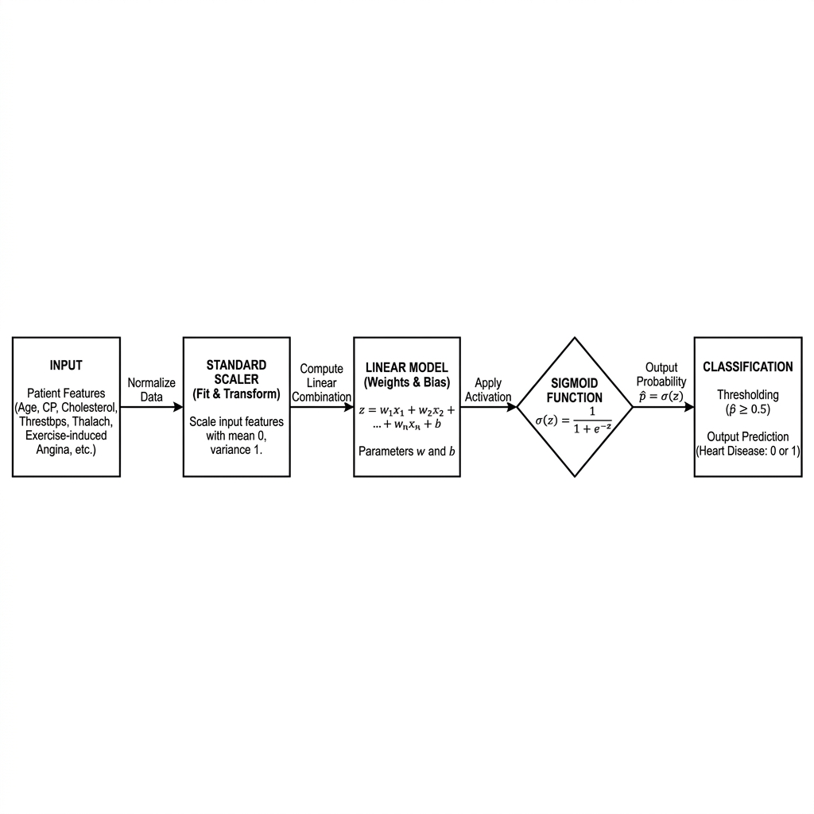
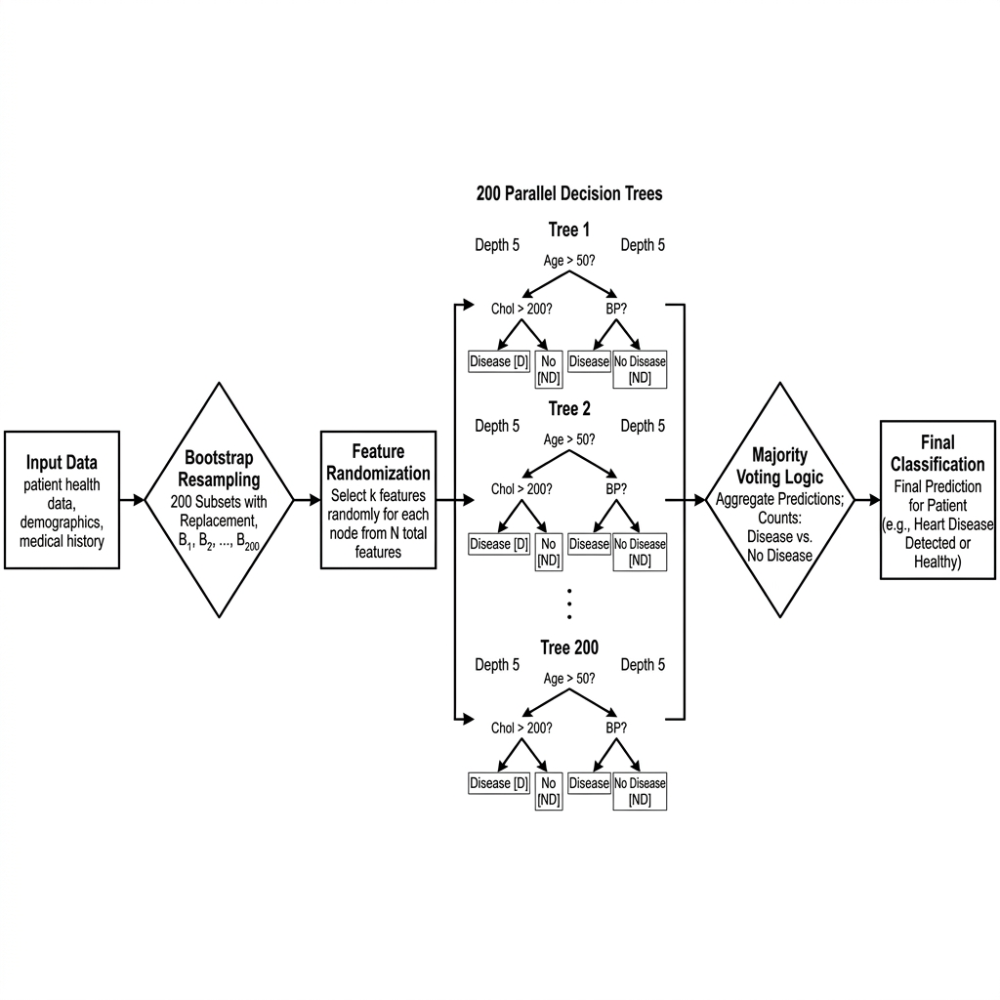
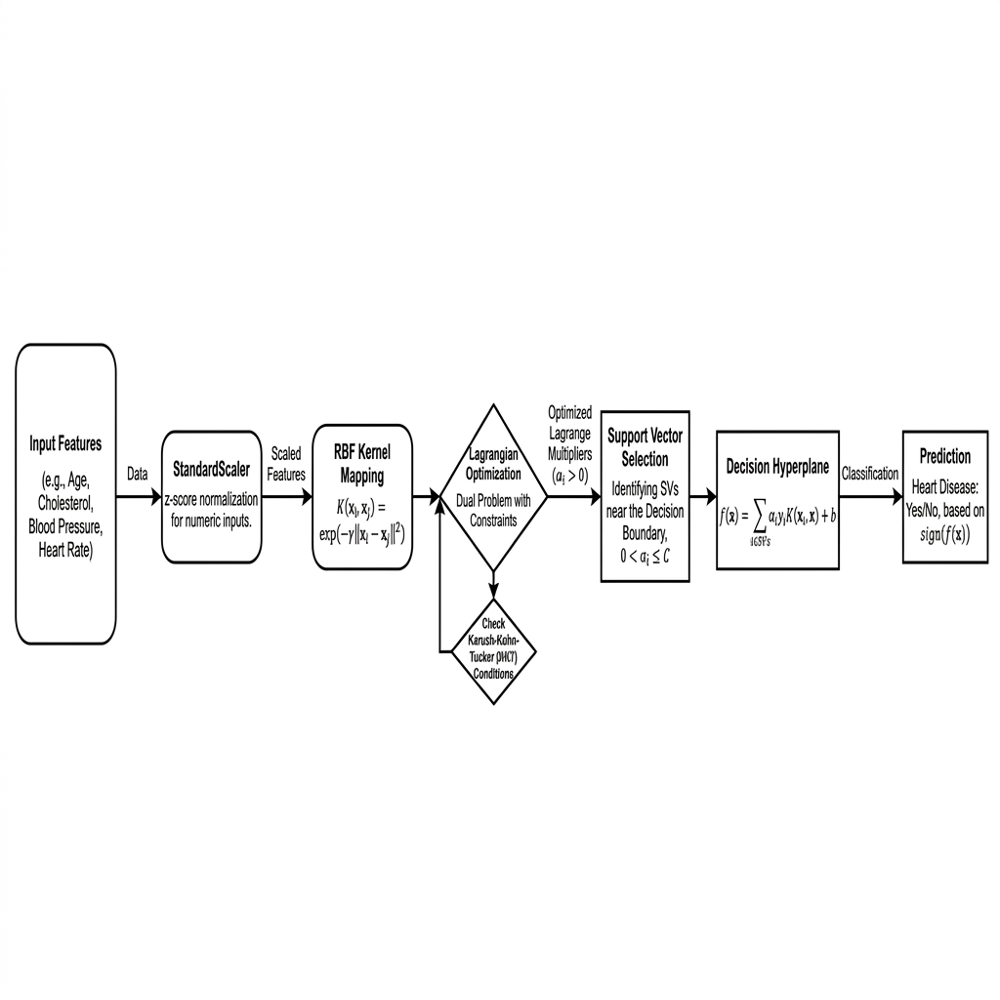
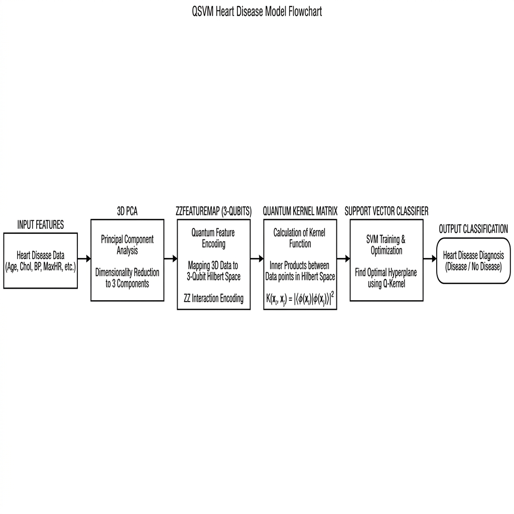
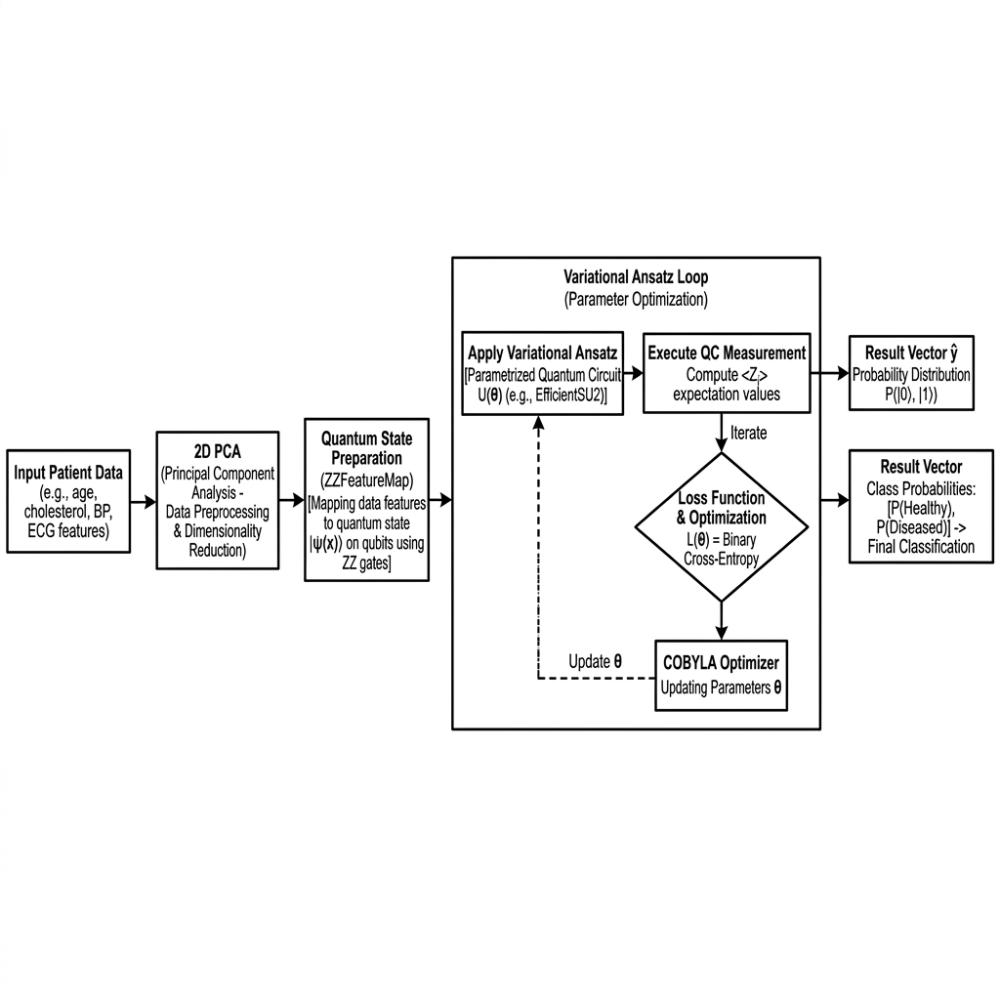

# Mini-Quantum: Academic Horizontal Flowcharts

This document provides high-resolution, academic-standard horizontal flowcharts for the 5 machine learning and quantum algorithms implemented in the project. These flowcharts are designed for use in professional publications and technical presentations.

---

## 1. Logistic Regression (Horizontal Architecture)

**Description**: Traces the linear sequence from feature normalization to sigmoid activation in a left-to-right academic format.

---

## 2. Random Forest (Ensemble Horizontal Flow)

**Description**: Visualizes the parallel execution of 200 decision trees followed by the majority voting logic that determines the final diagnosis.

---

## 3. Support Vector Machine (RBF Horizontal Path)

**Description**: Illustrates the transition from raw patient data to the high-dimensional RBF space and the subsequent hyperplane decision.

---

## 4. Quantum SVM (QSVM Horizontal Circuitry)

**Description**: Shows the bridge between classical PCA reduction and the 3-qubit ZZFeatureMap encoding used in the Fidelity Quantum Kernel.

---

## 5. VQC (Variational Horizontal Learning Loop)

**Description**: A professional visualization of the quantum-classical hybrid loop, featuring the RealAmplitudes ansatz and the COBYLA optimization cycle.

---

## 📁 File Locations
All high-resolution PNG source files are stored locally at:
`docs/images/horizontal_academic/`

You can directly copy these files for use in your research paper or thesis.
