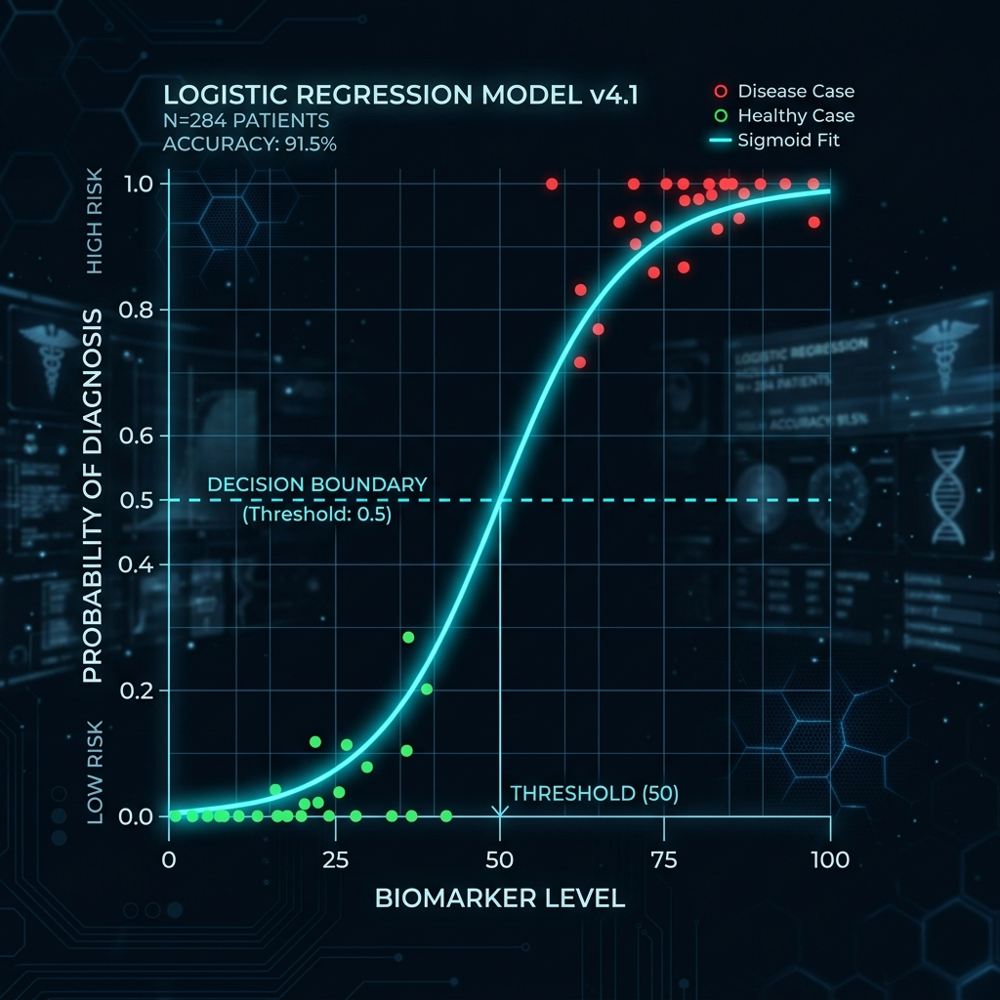
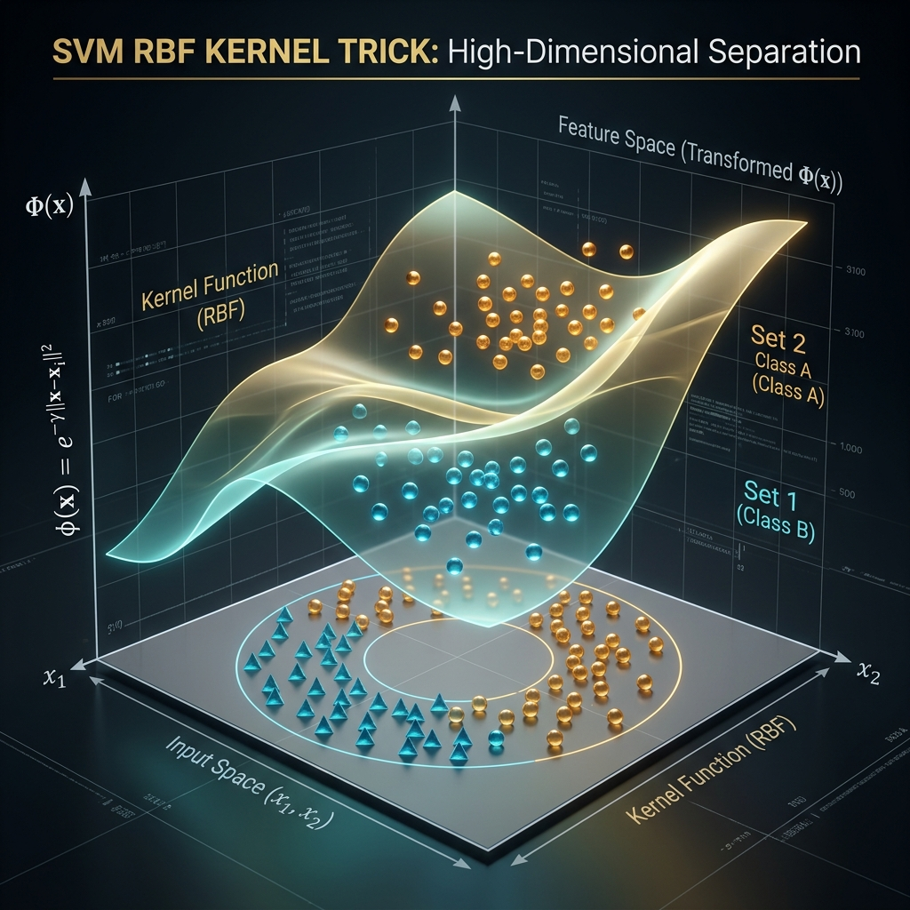
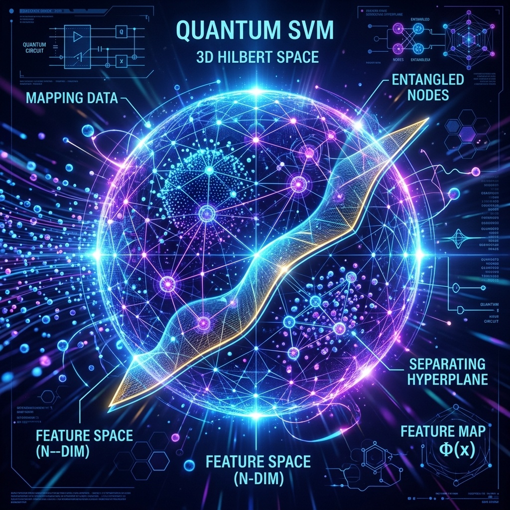

# Mini-Quantum: Algorithm Visual Gallery

This gallery provides high-fidelity, professional visualizations of the machine learning and quantum algorithms used in the **Mini-Quantum** platform.

---

## 1. Logistic Regression (The Sigmoid Filter)

**Logic**: Maps patient features to a single probability curve using a linear weighted sum.

---

## 2. Random Forest (The Ensemble Jury)

**Logic**: A robust ensemble of 200 decision trees (max depth 5) that vote on the final heart disease prediction.

---

## 3. Support Vector Machine (The RBF Kernel)

**Logic**: Uses a non-linear "Radial Basis Function" (RBF) to warp data into higher dimensions, creating an optimal boundary between healthy and diseased states.

---

## 4. Quantum SVM (The Hilbert Space Expansion)

**Logic**: Uses a **ZZFeatureMap** to encode 3-dimensional PCA data into a quantum Hilbert space where complex patterns are decoded by a quantum kernel.

---

## 5. VQC (The Variational Tuning Loop)

**Logic**: An iterative quantum-classical hybrid system where the **COBYLA** optimizer tunes the **RealAmplitudes** ansatz circuit over 20 cycles to find the lowest loss.

---

## 🎨 Asset Usage
These images are stored locally in `docs/images/`. You can use them for:
- Project presentations and pitch decks.
- Technical documentation or university reports.
- UI mockups for future dashboard upgrades.
