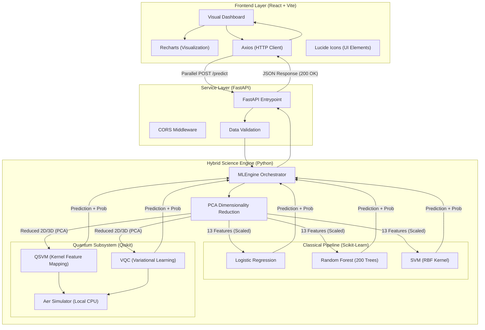

# Mini-Quantum: Master System Architecture

This document outlines the high-level architecture of the **Mini-Quantum** hybrid ML platform, showing the interaction between the React frontend, FastAPI service, and the dual-stream machine learning engine.

## 1. High-Level Technical Architecture

## 2. Tiered System Breakdown

### A. Presentation Tier
- **Technology**: React v18, Vite.
- **Responsibility**: User interface, data input for patient features, and data visualization.
- **Parallelization Strategy**: Axios fires all model prediction requests simultaneously to prevent the slow quantum simulations from blocking the fast classical models.

### B. Logic Tier (MLEngine)
- **Technology**: Python, FastAPI.
- **Responsibility**: Orchestrating the "Hybrid Split." 
- **PCA Dimensionality Reduction**: Crucial for quantum algorithms, which cannot yet handle high-dimensional data (13 features) on classical hardware/simulators.

### C. Science Tier (The Models)
- **Classical**: Logistic Regression, Random Forest (200 trees, max depth 5), SVM.
- **Quantum**: QSVM with Fidelity Kernel (3D PCA), VQC with RealAmplitudes Ansatz (2D PCA).
- **Simulation Layer**: Qiskit Aer allows us to run these complex quantum gates on standard binary CPUs.
