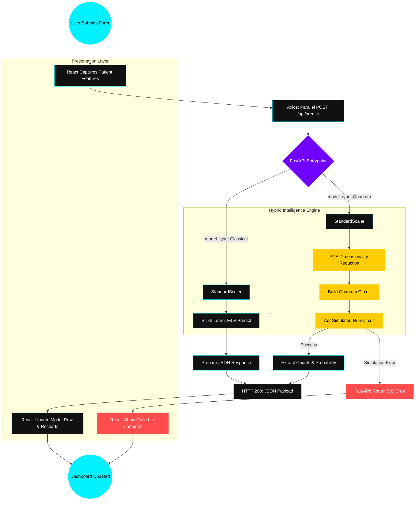

# Mini-Quantum: Prediction Lifecycle Flow

This document tracks the journey of a single patient diagnosis request, highlighting the parallel execution of classical and quantum tasks.

## Full Prediction Flow Chart

## Key Technical Details

### 1. The Parallelization Strategy
- **Frontend**: The `ComparisonDashboard.jsx` uses a `forEach` loop with `async/await` to fire requests for all 5 models simultaneously. This means the total wait time is governed by the *slowest* model (VQC), rather than the *sum* of all models.

### 2. The Dimensionality Gap (PCA)
- **Problem**: Quantum simulators take exponential time for every added feature.
- **Solution**: The architecture includes a **PCA (Principal Component Analysis)** step that compresses the 13 patient features into **2 or 3 essential dimensions** (qubits) for quantum processing.

### 3. Graceful Error Resilience
- If a quantum simulation fails (e.g., due to a memory limit on the local machine), the FastAPI backend catches the exception and returns a **500 error**.
- The React dashboard is programmed to catch these errors *per-model*, allowing the rest of the dashboard to stay functional.
