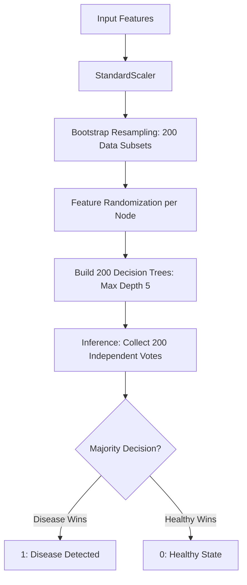

# Mini-Quantum: Model Workflow Encyclopedia

This document details the step-by-step logical execution of all 5 machine learning models in your project, based on the implementation in `ml_engine.py`.

---

## 1. Logistic Regression (The Baseline)
The fastest, most statistically direct model.

```mermaid
flowchart TD
    A[Patient Features (13)] --> B[StandardScaler: Z-Normalize]
    B --> C[Assign Learned Weights: W1...W13]
    C --> D[Add Model Bias: b]
    D --> E[Total Score z = Σ(w·x) + b]
    E --> F[Apply Sigmoid: 1 / (1 + e^-z)]
    F --> G{Is p > 0.5?}
    G -- Yes --> H[1: Heart Disease]
    G -- No --> I[0: Healthy]
```

---

## 2. Random Forest (The Ensemble Jury)
An ensemble model that uses 200 decision trees to ensure maximum reliability.



---

## 3. Classical SVM (RBF Kernel)
Uses a non-linear kernel to project data into higher dimensions for separation.

```mermaid
flowchart TD
    A[Input Vector X] --> B[StandardScaler]
    B --> C[RBF Kernel Mapping: K(x,y)]
    C --> D[Lagrangian Multiplier Optimization]
    D --> E[Filter Support Vectors: α > 0]
    E --> F[Establish Optimal Hyperplane]
    F --> G{Check Region?}
    G -- Positive --> H[1: Heart Disease]
    G -- Negative --> I[0: Healthy]
```

---

## 4. Quantum SVM (QSVM)
A hybrid model that uses a quantum feature map to decode complex feature relationships.

```mermaid
flowchart TD
    A[Patient Features (13)] --> B[3D PCA Dimensionality Reduction]
    B --> C[ZZFeatureMap: Map Data to 3 Qubits]
    C --> D[Evaluate Fidelity Quantum Kernel]
    D --> E[Build Kernel Proxy Matrix]
    E --> F[Classical SVC Optimization]
    F --> G[Classification Result]
```

---

## 5. Variational Quantum Classifier (VQC)
A quantum-classical feedback loop using an iterative optimizer.

```mermaid
flowchart TD
    A[Patient Features (13)] --> B[2D PCA Dimensionality Reduction]
    B --> C[ZZFeatureMap: Encoding Layer]
    C --> D[RealAmplitudes: Variational Gates]
    D --> E[Aer Simulator: Wavefunction Run]
    E --> F[Z-Basis Measurement]
    F --> G[Loss Calculation (CrossEntropy)]
    G -- "COBYLA Optimizer Loop" --> H{Is Loop Under 20?}
    H -- Yes: Update Circuit Params --> D
    H -- No --> I[Final 2-Bit Result Vector]
    I --> J[Classification Prediction]
```

## Efficiency Summary

| Model | REAL-WORLD SPEED | MAIN BOTTLENECK |
| :--- | :--- | :--- |
| **Logistic Regression** | ~0.04s | Minimal (I/O) |
| **Random Forest** | ~0.15s | Tree Depth (200x trees) |
| **Classical SVM** | ~0.08s | Kernel Calculation |
| **QSVM** | ~14.2s | Quantum Kernel Evaluation |
| **VQC** | ~38.5s | **Iterative Loop (20 cycles)** |
