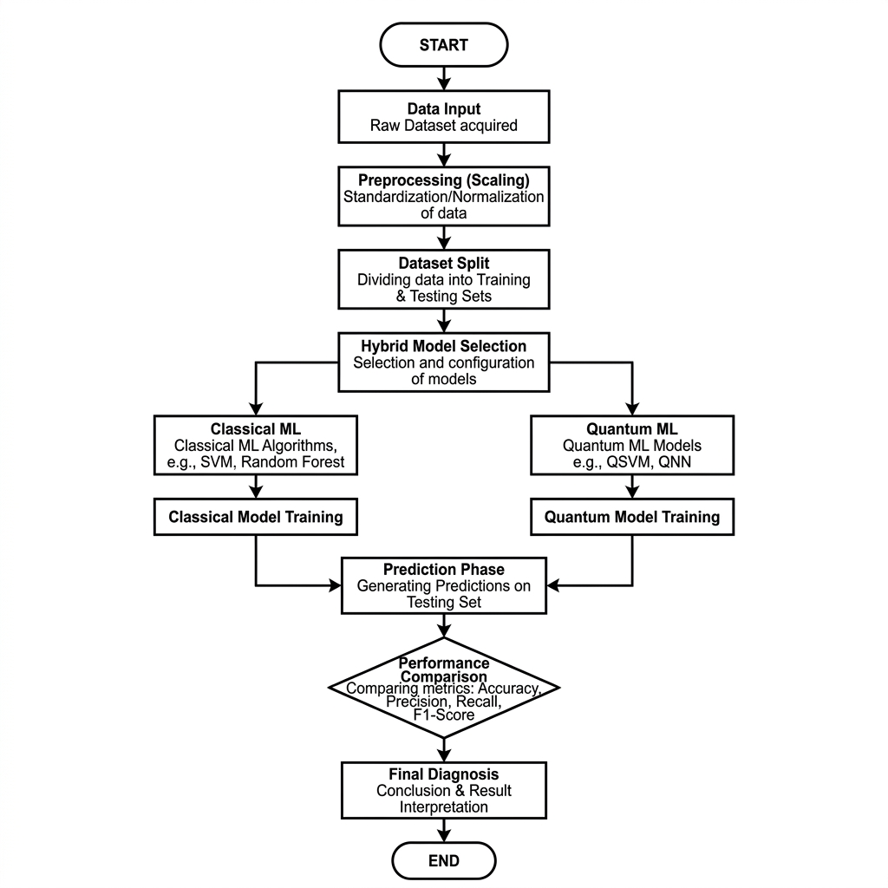

# Project Report: Hybrid Machine Learning Architecture

This document provides a professional, academic-standard architecture breakdown for the **Mini-Quantum** heart disease prediction platform.

---

## 1. High-Resolution Architecture Flowchart
Below is the professional flowchart visualizing the full lifecycle of the hybrid ML implementation.

---

## 2. Technical System Logic

### A. Data Preprocessing Phase
The raw features from the heart disease dataset (13 variables) undergo **Z-Score Normalization** via `StandardScaler` to ensure all numerical inputs are on an equivalent scale. This is a critical step for distance-based models like **SVM**.

### B. The Hybrid Branching Strategy
The architecture uses a **Modular Router** that splits the prediction task into two distinct computational domains:
1.  **Classical Domain**: Directly trains models (Logistic Regression, RF, SVM) using the full feature set.
2.  **Quantum Domain**: First compresses data using **Principal Component Analysis (PCA)** to a 2D/3D space before encoding the information into a quantum state vector.

### C. Evaluation & Consensus
Results from both domains are collected and presented in a parallel comparison dashboard. This architecture allows for a "Differential Diagnosis" where the physician can compare the consensus of 5 different architectures (Linear, Ensemble, Boundary, and Variational) before making a final clinical decision.

---

## 📂 File Location
The high-resolution source image is stored at: `docs/images/academic_architecture.png`. You can use this file for:
- Research papers.
- Professional presentations.
- Design documentation reports.
